# Harness Rendering Implementation Plan

> **For Claude:** REQUIRED SUB-SKILL: Use recs-executing-plans to implement this plan task-by-task.

**Goal:** Render one package per harness from capability markers in the skill text and a harness profile per harness, with the order of the skills kept in a skill flow, and the Claude Code rendering byte-identical to today's skill text.

**Architecture:** `packaging/markers.mjs` finds and renders capability markers; `packaging/flow.mjs` reads and checks the skill flow; `packaging/render.mjs` renders a package from `skills/`, `agents/` and `packaging/profiles/<harness>.json`, refusing on any problem; `packaging/build.mjs` stays the command line. Validation, CI and evals then run on renderings.

**Tech Stack:** Node 22+ ES modules, `node:test`; Graphviz dot (parsed by line, no dependency); pi 0.87.1 extension API (TypeScript, loaded by pi); promptfoo 0.124.1; bubblewrap; GitHub Actions.

---

## How to Speak

The ubiquitous language is in `docs/ubiquitous-language.org`. The terms this
work names are realization terms, so they are defined in architectural
decisions, not the ubiquitous language. This plan's work touches:

- **harness capability** — a kind of action whose means differs by harness: delegate, hand off (`handoff`), clear, load, harness tool (`tool`), ask, memory, restrict (ADR-10: Render each harness's package from capability markers and a harness profile).
- **capability marker** — `{{trf: <harness capability> <arguments>}}` in the skill text, standing for a harness-dependent phrase (ADR-10).
- **harness profile** — states, for each harness capability, what the harness has and how its skill text says it, and the files its package carries (ADR-10).
- **rendering** — producing a harness's package from the skill text and its harness profile (ADR-10).
- **skill flow** — `skills/skill-flow.dot`, the order of the skills (ADR-11: Keep the order of the skills in a skill flow beside them).
- **memory file** — where a harness without a task list keeps the memory harness capability's list, outside the project's tracked tree (design document).
- **brief** / **sentence** — the two forms of a delegate capability marker: a heading above a prompt, or inside a sentence (design document).
- **prompt template** — a file beside a skill that a delegate is given (the skills' existing word).
- **record**, **citation**, **realization**, **realization modality** — UL-4: Record, UL-9: Citation, UL-22: Realization, UL-24: Realization modality.

Use them exactly, in code, tests, comments, and commit messages. Coin nothing.
The values `in-progress` and `completed` (memory's arguments) and the
statuses `native`, `extension`, `prose`, `absent` are the ones in the design
document; add no others.

## Do Not Modify

- `docs/vision.org`
- `docs/ubiquitous-language.org`, `docs/architectural-decisions.org`, `docs/features.org`, `docs/user-workflows.org`, `docs/message-catalog.org`
- every file under `docs/ubiquitous-language/`, `docs/architectural-decisions/`, `docs/features/`, `docs/user-workflows/`, `docs/message-catalog/`
- every existing `evals/cases/*/fixture/` and `evals/cases/*/prompt.md`
- `docs/plans/2026-10-19-harness-rendering-design.md`

If any task seems to require changing one of these, STOP and raise it with
the user. The plan does not proceed around it.

## Reading List

Read before executing any task, in this order:

1. UW-7: Realize a change to the system — the workflow whose steps the skill flow cites
2. UW-8: Start a project's records from its realization — recs-kickstart's workflow, cited by the skill flow
3. ADR-10: Render each harness's package from capability markers and a harness profile — what rendering is
4. ADR-11: Keep the order of the skills in a skill flow beside them — what the skill flow is and what rendering checks against it
5. ADR-9: The code realization skills are a prototype adapted from superpowers — cited by the skill flow's prototype edges
6. ADR-2: The recs files live apart from any project that uses them — why a shipped skill flow carries no citations (Task 5)
7. ADR-1: A record change is one commit of its own — no task here changes a record
8. `docs/plans/2026-10-19-harness-rendering-design.md` — the design below the records
9. `docs/knowledge-base/pi-as-an-eval-harness.org` and `docs/knowledge-base/bubblewrap-confines-an-eval-run.org` — before Tasks 7–8

## Cataloged-Text Ordering

No task touches cataloged text: rendering's refusals belong to packaging, outside the system the records describe.

## Safety

Never run an agent or an eval outside bubblewrap. Never `find` over `/`,
`/mnt` or a home directory. Run every command from the worktree root,
`.worktrees/harness-rendering`.

---

### Task 1: Capability markers

**Records:** ADR-10: Render each harness's package from capability markers and a harness profile

**Files:**
- Create: `packaging/markers.mjs`
- Test: `packaging/test/markers.test.mjs`

**Step 1: Write the failing test**

```js
// packaging/test/markers.test.mjs
import { test } from 'node:test';
import assert from 'node:assert/strict';
import { markers, renderText, checkProfile, capabilities } from '../markers.mjs';

const profile = {
  harness: 'test',
  capabilities: {
    delegate: {
      status: 'native',
      brief: 'Call ({role})',
      sentence: 'Call with {role} type',
      'brief-role-file': 'Call (general-purpose, with `{roleFile}` first in its prompt)',
      'sentence-role-file': 'Call with `{roleFile}` first in its prompt',
      roles: { 'recs-code-reviewer': 'role file' },
      roleNames: { 'general-purpose': 'self' },
    },
    handoff: { status: 'prose' },
    clear: { status: 'prose' },
    load: { status: 'native', skill: '{skill}' },
    tool: { status: 'native' },
    ask: { status: 'prose' },
    memory: { status: 'native', list: 'Todo', 'in-progress': 'doing', completed: 'done' },
    restrict: { status: 'prose' },
  },
};
const context = {
  file: 'skills/recs-a/prompt.md',
  roleFile: 'skills/recs-requesting-code-review/reviewer-role.md',
  roles: ['recs-code-reviewer'],
  skills: ['recs-a', 'recs-b'],
};

test('finds capability markers and their arguments', () => {
  assert.deepEqual(markers('x {{trf: load recs-b}} y {{trf:memory}}'), [
    { raw: '{{trf: load recs-b}}', keyword: 'load', args: ['recs-b'] },
    { raw: '{{trf:memory}}', keyword: 'memory', args: [] },
  ]);
});

test('renders each harness capability from the harness profile', () => {
  const { text, problems } = renderText(
    [
      '{{trf: delegate general-purpose brief}}:',
      'Use {{trf: delegate recs-code-reviewer sentence}}, fill',
      '{{trf: delegate recs-code-reviewer brief}}:',
      'Create {{trf: memory}} and proceed',
      'Mark as {{trf: memory in-progress}} then {{trf: memory completed}}',
      'Use {{trf: load recs-b}}',
    ].join('\n'),
    profile,
    context,
  );
  assert.deepEqual(problems, []);
  assert.equal(text, [
    'Call (self):',
    'Use Call with `../recs-requesting-code-review/reviewer-role.md` first in its prompt, fill',
    'Call (general-purpose, with `../recs-requesting-code-review/reviewer-role.md` first in its prompt):',
    'Create Todo and proceed',
    'Mark as doing then done',
    'Use recs-b',
  ].join('\n'));
});

test('refuses what it cannot render', () => {
  const { problems } = renderText(
    [
      '{{trf: teleport}}',
      '{{trf: delegate general-purpose}}',
      '{{trf: delegate stranger brief}}',
      '{{trf: memory sideways}}',
      '{{trf: load recs-z}}',
      '{{trf: ask}}',
    ].join('\n'),
    profile,
    context,
  );
  assert.equal(problems.length, 6);
  assert.match(problems[0], /teleport is not a harness capability/);
  assert.match(problems[1], /delegate takes a role and a form, brief or sentence/);
  assert.match(problems[2], /stranger is not general-purpose or an agent under agents/);
  assert.match(problems[3], /memory takes nothing, in-progress or completed/);
  assert.match(problems[4], /recs-z is not a skill under skills/);
  assert.match(problems[5], /ask has no capability marker yet/);
});

test('a harness profile names every harness capability, with a status and its entries', () => {
  assert.deepEqual(checkProfile(profile), []);
  const gappy = structuredClone(profile);
  delete gappy.capabilities.restrict;
  gappy.capabilities.ask.status = 'maybe';
  delete gappy.capabilities.memory.completed;
  delete gappy.capabilities.delegate['sentence-role-file'];
  assert.deepEqual(checkProfile(gappy), [
    'test: ask has status maybe, not native, extension, prose or absent',
    'test: restrict is missing',
    'test: delegate has no sentence-role-file entry',
    'test: memory has no completed entry',
  ]);
  assert.equal(capabilities.length, 8);
});
```

**Step 2: Run test to verify it fails**

Run: `node --test packaging/test/`
Expected: FAIL with `Cannot find module` for `../markers.mjs`

**Step 3: Write minimal implementation**

```js
// packaging/markers.mjs
import fs from 'node:fs';
import path from 'node:path';

export const capabilities = ['delegate', 'handoff', 'clear', 'load', 'tool', 'ask', 'memory', 'restrict'];
export const statuses = ['native', 'extension', 'prose', 'absent'];
const pattern = /\{\{trf:\s*([^}]*?)\s*\}\}/g;
const entries = { delegate: ['brief', 'sentence'], load: ['skill'], memory: ['list', 'in-progress', 'completed'] };

export function fill(value, vars) {
  if (typeof value === 'string') return value.replace(/\{(\w+)\}/g, (m, k) => (vars[k] === undefined ? m : vars[k]));
  if (Array.isArray(value)) return value.map((v) => fill(v, vars));
  if (value && typeof value === 'object') return Object.fromEntries(Object.entries(value).map(([k, v]) => [k, fill(v, vars)]));
  return value;
}

function parse(body) {
  const [keyword, ...args] = body.split(/\s+/).filter(Boolean);
  return { keyword, args };
}

export function markers(text) {
  return [...text.matchAll(pattern)].map((m) => ({ raw: m[0], ...parse(m[1]) }));
}

function entry(profile, { keyword, args }, context) {
  const c = profile.capabilities?.[keyword];
  if (!c) return { problem: `the ${profile.harness} harness profile has no ${keyword}` };
  if (keyword === 'delegate') {
    const [role, form] = args;
    if (args.length !== 2 || !['brief', 'sentence'].includes(form)) return { problem: 'delegate takes a role and a form, brief or sentence' };
    if (role !== 'general-purpose' && !(context.roles ?? []).includes(role)) return { problem: `${role} is not general-purpose or an agent under agents/` };
    const how = role === 'general-purpose' ? 'native' : c.roles?.[role];
    if (!how) return { problem: `the ${profile.harness} harness profile does not say how it carries ${role}` };
    const roleFile = path.posix.relative(path.posix.dirname(context.file ?? ''), context.roleFile ?? '');
    return { template: c[how === 'role file' ? `${form}-role-file` : form], vars: { role: c.roleNames?.[role] ?? role, roleFile } };
  }
  if (keyword === 'memory') {
    if (args.length > 1 || (args.length === 1 && !['in-progress', 'completed'].includes(args[0]))) return { problem: 'memory takes nothing, in-progress or completed' };
    return { template: c[args[0] ?? 'list'], vars: {} };
  }
  if (keyword === 'load') {
    if (args.length !== 1) return { problem: 'load takes one skill' };
    if (context.skills && !context.skills.includes(args[0])) return { problem: `${args[0]} is not a skill under skills/` };
    return { template: c.skill, vars: { skill: args[0] } };
  }
  return { problem: `${keyword} has no capability marker yet` };
}

export function renderText(text, profile, context = {}) {
  const problems = [];
  const rendered = text.replace(pattern, (raw, body) => {
    const marker = parse(body);
    if (!capabilities.includes(marker.keyword)) {
      problems.push(`${raw}: ${marker.keyword} is not a harness capability`);
      return raw;
    }
    const { problem, template, vars } = entry(profile, marker, context);
    if (problem || typeof template !== 'string') {
      problems.push(`${raw}: ${problem ?? `the ${profile.harness} harness profile has no entry for it`}`);
      return raw;
    }
    return fill(template, vars);
  });
  return { text: rendered, problems };
}

export function checkProfile(profile) {
  const problems = [];
  const c = profile.capabilities ?? {};
  for (const name of capabilities) {
    if (!c[name]) problems.push(`${profile.harness}: ${name} is missing`);
    else if (!statuses.includes(c[name].status)) problems.push(`${profile.harness}: ${name} has status ${c[name].status}, not ${statuses.slice(0, -1).join(', ')} or ${statuses.at(-1)}`);
  }
  problems.sort((a, b) => a.includes('is missing') - b.includes('is missing'));
  for (const [name, keys] of Object.entries(entries)) {
    const needed = name === 'delegate' && Object.values(c.delegate?.roles ?? {}).includes('role file')
      ? [...keys, 'brief-role-file', 'sentence-role-file']
      : keys;
    for (const key of needed) if (c[name] && typeof c[name][key] !== 'string') problems.push(`${profile.harness}: ${name} has no ${key} entry`);
  }
  return problems;
}

export function leftovers(dir, base = dir) {
  return fs.readdirSync(dir, { withFileTypes: true }).flatMap((e) => {
    const full = path.join(dir, e.name);
    if (e.isDirectory()) return leftovers(full, base);
    return fs.readFileSync(full, 'utf8').includes('{{trf:') ? [`${path.relative(base, full)}: a capability marker was left unrendered`] : [];
  });
}
```

**Step 4: Run test to verify it passes**

Run: `node --test packaging/test/`
Expected: PASS, 4 tests

**Step 5: Commit**

```bash
git add packaging/markers.mjs packaging/test/markers.test.mjs
git commit -m "feat: render capability markers from a harness profile

ADR-10: Render each harness's package from capability markers and a
harness profile. Markers are found, rendered and refused here, before
any skill carries one."
```

---

### Task 2: Harness profiles

**Records:** ADR-10: Render each harness's package from capability markers and a harness profile

**Files:**
- Create: `packaging/profiles/claude.json`, `packaging/profiles/codex.json`, `packaging/profiles/pi.json`, `packaging/profiles/agy.json`
- Test: `packaging/test/profiles.test.mjs`

**Step 1: Write the failing test**

```js
// packaging/test/profiles.test.mjs
import { test } from 'node:test';
import assert from 'node:assert/strict';
import fs from 'node:fs';
import path from 'node:path';
import { fileURLToPath } from 'node:url';
import { checkProfile } from '../markers.mjs';

const dir = path.join(path.dirname(fileURLToPath(import.meta.url)), '..', 'profiles');

for (const harness of ['claude', 'codex', 'pi', 'agy']) {
  test(`the ${harness} harness profile is complete`, () => {
    const profile = JSON.parse(fs.readFileSync(path.join(dir, `${harness}.json`), 'utf8'));
    assert.equal(profile.harness, harness);
    assert.deepEqual(checkProfile(profile), []);
    for (const key of ['name', 'contents', 'install', 'agents', 'files']) assert.ok(profile[key], `no ${key}`);
    assert.ok(!JSON.stringify(profile.capabilities).includes('\\"'), 'an entry holds a double quote, which breaks a Graphviz label');
  });
}
```

**Step 2: Run test to verify it fails**

Run: `node --test packaging/test/`
Expected: FAIL with `ENOENT` for `profiles/claude.json`

**Step 3: Check Antigravity's delegate before writing its harness profile**

Read Antigravity's documentation on `invoke_subagent` and on plugin agents
(`agents/*.md` with `subagent: true`). Establish two things: the TypeName of a
general-purpose subagent (expected `self`), and whether a plugin's agent is
invoked by its `name`. If a plugin agent is invoked by name, keep
`"recs-code-reviewer": "native"` below. If not, set it to `"role file"`, add
`brief-role-file` and `sentence-role-file` entries shaped like Codex's, and
set `"agents": "role file"`. Add what you found to the knowledge base as
`docs/knowledge-base/antigravity-subagents.org`, with its source.

**Step 4: Write the harness profiles**

`packaging/profiles/claude.json`:

```json
{
  "harness": "claude",
  "name": "Claude Code",
  "contents": "the skills and the `recs-code-reviewer` subagent",
  "install": ["claude plugin marketplace add Trevoke/{repo}", "claude plugin install {plugin}@the-recs-files"],
  "agents": "copy",
  "capabilities": {
    "delegate": {
      "status": "native",
      "brief": "Task tool ({role})",
      "sentence": "Task tool with {role} type",
      "roles": { "recs-code-reviewer": "native" }
    },
    "handoff": { "status": "prose" },
    "clear": { "status": "native" },
    "load": { "status": "native", "skill": "{skill}" },
    "tool": { "status": "native" },
    "ask": { "status": "native" },
    "memory": { "status": "native", "list": "TodoWrite", "in-progress": "in_progress", "completed": "completed" },
    "restrict": { "status": "prose" }
  },
  "files": {
    ".claude-plugin/plugin.json": {
      "name": "{plugin}", "version": "{version}", "description": "{description}", "author": { "name": "{author}" },
      "homepage": "{source}", "repository": "{source}", "license": "MIT"
    },
    ".claude-plugin/marketplace.json": {
      "name": "the-recs-files", "description": "{description}", "owner": { "name": "{author}" },
      "plugins": [{ "name": "{plugin}", "source": "./", "description": "{description}", "version": "{version}" }]
    }
  }
}
```

`packaging/profiles/codex.json`:

```json
{
  "harness": "codex",
  "name": "Codex",
  "contents": "the skills",
  "install": ["codex plugin marketplace add Trevoke/{repo}", "codex plugin add {plugin}@the-recs-files"],
  "agents": "role file",
  "capabilities": {
    "delegate": {
      "status": "native",
      "brief": "spawn_agent ({role})",
      "sentence": "spawn_agent ({role})",
      "brief-role-file": "spawn_agent (general-purpose, with `{roleFile}` first in its prompt)",
      "sentence-role-file": "spawn_agent with `{roleFile}` first in its prompt",
      "roles": { "recs-code-reviewer": "role file" }
    },
    "handoff": { "status": "prose" },
    "clear": { "status": "native" },
    "load": { "status": "native", "skill": "{skill}" },
    "tool": { "status": "native" },
    "ask": { "status": "prose" },
    "memory": { "status": "native", "list": "the `update_plan` plan", "in-progress": "in_progress", "completed": "completed" },
    "restrict": { "status": "prose" }
  },
  "files": {
    "plugin.json": {
      "$schema": "https://agent-plugins.org/schemas/1.0.0/plugin.schema.json",
      "name": "{plugin}", "version": "{version}", "description": "{description}"
    },
    ".agents/plugins/marketplace.json": {
      "name": "the-recs-files",
      "plugins": [{
        "name": "{plugin}",
        "source": { "source": "local", "path": "./" },
        "policy": { "installation": "AVAILABLE", "authentication": "ON_INSTALL" },
        "category": "Coding"
      }]
    }
  }
}
```

`packaging/profiles/pi.json` (delegate's status becomes `extension` in Task 6, when the extension ships):

```json
{
  "harness": "pi",
  "name": "pi",
  "contents": "the skills",
  "install": ["pi install git:github.com/Trevoke/{repo}@v{version}"],
  "agents": "role file",
  "capabilities": {
    "delegate": {
      "status": "absent",
      "brief": "subagent tool ({role})",
      "sentence": "the subagent tool",
      "brief-role-file": "subagent tool (general-purpose, with `{roleFile}` first in its prompt)",
      "sentence-role-file": "the subagent tool with `{roleFile}` first in its prompt",
      "roles": { "recs-code-reviewer": "role file" }
    },
    "handoff": { "status": "prose" },
    "clear": { "status": "native" },
    "load": { "status": "native", "skill": "{skill}" },
    "tool": { "status": "native" },
    "ask": { "status": "prose" },
    "memory": {
      "status": "prose",
      "list": "the memory file (`/tmp/recs-files-memory-<the project directory's name>.md`, a checklist)",
      "in-progress": "in progress in the memory file",
      "completed": "completed in the memory file"
    },
    "restrict": { "status": "prose" }
  },
  "files": {
    "package.json": {
      "name": "{repo}", "version": "{version}", "description": "{description}", "license": "MIT", "repository": "{source}",
      "keywords": ["pi-package"],
      "pi": { "skills": ["./skills"] }
    }
  }
}
```

`packaging/profiles/agy.json`:

```json
{
  "harness": "agy",
  "name": "Antigravity",
  "contents": "the skills and the `recs-code-reviewer` subagent",
  "install": ["agy plugin install https://github.com/Trevoke/{repo}"],
  "agents": "generate",
  "agentFrontmatter": { "tools": ["view_file", "grep_search", "run_command"], "mainAgent": false, "subagent": true, "model": "inherit" },
  "capabilities": {
    "delegate": {
      "status": "native",
      "brief": "invoke_subagent ({role})",
      "sentence": "invoke_subagent with the {role} agent",
      "roles": { "recs-code-reviewer": "native" },
      "roleNames": { "general-purpose": "self" }
    },
    "handoff": { "status": "prose" },
    "clear": { "status": "prose" },
    "load": { "status": "native", "skill": "{skill}" },
    "tool": { "status": "native" },
    "ask": { "status": "prose" },
    "memory": {
      "status": "native",
      "list": "the task artifact (a markdown checklist)",
      "in-progress": "in progress in the task artifact",
      "completed": "done in the task artifact"
    },
    "restrict": { "status": "native" }
  },
  "files": {
    "plugin.json": { "$schema": "https://antigravity.google/schemas/v1/plugin.json", "name": "{plugin}", "description": "{description}" }
  }
}
```

Apply what Step 3 established to `agy.json` before running the tests.

**Step 5: Run test to verify it passes**

Run: `node --test packaging/test/`
Expected: PASS, 8 tests

**Step 6: Commit**

```bash
git add packaging/profiles docs/knowledge-base/antigravity-subagents.org packaging/test/profiles.test.mjs
git commit -m "feat: add a harness profile for each harness

ADR-10: Render each harness's package from capability markers and a
harness profile. Each names all eight harness capabilities, the entries
its capability markers render to, and the files its package carries."
```

---

### Task 3: Render packages from the harness profiles

**Records:** ADR-10: Render each harness's package from capability markers and a harness profile

The packages must come out identical to what `packaging/build.mjs` builds
today: no skill carries a capability marker yet.

**Files:**
- Create: `packaging/render.mjs`, `packaging/templates/release.yml`
- Modify: `packaging/build.mjs` (whole file)
- Test: `packaging/test/render.test.mjs`

**Step 1: Build today's packages as the baseline**

```bash
B=$(mktemp -d); echo "$B"
for h in claude codex pi agy; do node packaging/build.mjs $h "$B/$h" v1.2.3; done
```
Expected: four `built the-recs-files-<h> 1.2.3 in …` lines. Keep `$B`.

**Step 2: Write the failing test**

```js
// packaging/test/render.test.mjs
import { test } from 'node:test';
import assert from 'node:assert/strict';
import fs from 'node:fs';
import os from 'node:os';
import path from 'node:path';
import { render } from '../render.mjs';

for (const harness of ['claude', 'codex', 'pi', 'agy']) {
  test(`renders the ${harness} package with no capability marker left`, () => {
    const out = render(harness, fs.mkdtempSync(path.join(os.tmpdir(), `render-${harness}-`)), 'v1.2.3');
    assert.ok(fs.existsSync(path.join(out, 'skills', 'recs-writing-records', 'SKILL.md')));
    assert.ok(fs.existsSync(path.join(out, '.github', 'workflows', 'release.yml')));
    const all = fs.readdirSync(out, { recursive: true }).filter((f) => fs.statSync(path.join(out, f)).isFile());
    assert.ok(all.every((f) => !fs.readFileSync(path.join(out, f), 'utf8').includes('{{trf:')));
  });
}
```

**Step 3: Run test to verify it fails**

Run: `node --test packaging/test/`
Expected: FAIL with `Cannot find module` for `../render.mjs`

**Step 4: Move the release workflow into a template**

Write `packaging/templates/release.yml` with exactly the content of the
`releaseWorkflow` string in today's `packaging/build.mjs` (lines starting
`name: release` to the final `fi`), un-escaping `\${{` to `${{` and keeping
`actions/checkout@v4` (Task 6 moves it).

**Step 5: Write `packaging/render.mjs`**

```js
// packaging/render.mjs
import fs from 'node:fs';
import path from 'node:path';
import { fileURLToPath } from 'node:url';
import { fill, leftovers, renderText } from './markers.mjs';

export const root = path.join(path.dirname(fileURLToPath(import.meta.url)), '..');
export const harnesses = ['claude', 'codex', 'pi', 'agy'];
const roleFile = 'skills/recs-requesting-code-review/reviewer-role.md';
const vars = {
  plugin: 'recs-files',
  description: 'Skills for working on a project whose records are the source of truth.',
  author: 'Aldric Giacomoni',
  source: 'https://github.com/Trevoke/the-recs-files',
};

export function profile(harness) {
  return JSON.parse(fs.readFileSync(path.join(root, 'packaging', 'profiles', `${harness}.json`), 'utf8'));
}

function frontmatter(file) {
  const text = fs.readFileSync(path.join(root, file), 'utf8');
  const [, head, body] = text.match(/^---\n([\s\S]*?)\n---\n([\s\S]*)$/);
  const description = head.match(/^description: \|\n((?:  .*\n?)+)/m)?.[1].replace(/^  /gm, '').trim()
    ?? head.match(/^description: (.*)$/m)[1].trim();
  return { file, name: head.match(/^name: (.*)$/m)[1].trim(), description, body };
}

function yaml(key, value) {
  if (Array.isArray(value)) return `${key}:\n${value.map((v) => `  - ${v}`).join('\n')}`;
  if (typeof value === 'string' && value.includes('\n')) return `${key}: |\n${value.split('\n').map((l) => `  ${l}`).join('\n')}`;
  return `${key}: ${value}`;
}

function files(dir, base = dir) {
  return fs.readdirSync(dir, { withFileTypes: true }).flatMap((e) => {
    const full = path.join(dir, e.name);
    return e.isDirectory() ? files(full, base) : [path.relative(base, full)];
  }).sort();
}

export function render(harness, outArg, versionArg) {
  const p = profile(harness);
  const out = path.resolve(outArg);
  const v = { ...vars, version: versionArg.replace(/^v/, ''), repo: `the-recs-files-${harness}` };
  const problems = [];
  const write = (file, content) => {
    const full = path.join(out, file);
    fs.mkdirSync(path.dirname(full), { recursive: true });
    fs.writeFileSync(full, typeof content === 'string' ? content : `${JSON.stringify(content, null, 2)}\n`);
  };
  const copy = (from, to = from) => fs.cpSync(path.join(root, from), path.join(out, to), { recursive: true });

  fs.rmSync(out, { recursive: true, force: true });
  fs.mkdirSync(out, { recursive: true });

  const agents = fs.readdirSync(path.join(root, 'agents')).sort().map((f) => frontmatter(path.join('agents', f)));
  const skills = fs.readdirSync(path.join(root, 'skills'), { withFileTypes: true }).filter((e) => e.isDirectory()).map((e) => e.name);
  for (const rel of files(path.join(root, 'skills'))) {
    const file = path.join('skills', rel);
    const result = renderText(fs.readFileSync(path.join(root, file), 'utf8'), p, {
      file, roleFile, roles: agents.map((a) => a.name), skills,
    });
    problems.push(...result.problems.map((m) => `${file}: ${m}`));
    write(file, result.text);
  }

  copy('LICENSE');
  copy('CHANGELOG.md');
  write('.github/workflows/release.yml', fs.readFileSync(path.join(root, 'packaging', 'templates', 'release.yml'), 'utf8'));
  write('README.md', `# ${v.repo}

The [recs files](${v.source}) packaged for ${p.name}: ${p.contents}, version ${v.version}.

This repository is generated from ${v.source} on each release. Open issues and
pull requests there; changes made here are overwritten.

## Install

\`\`\`sh
${fill(p.install, v).join('\n')}
\`\`\`

Then open a project and ask for \`recs-kickstart\`.

## License

MIT; see \`LICENSE\`.
`);
  for (const [file, content] of Object.entries(p.files)) write(file, fill(content, v));
  for (const [to, from] of Object.entries(p.copy ?? {})) copy(from, to);

  if (p.agents === 'copy') copy('agents');
  if (p.agents === 'generate') {
    for (const a of agents) {
      const head = [yaml('name', a.name), `description: |\n${a.description.split('\n').map((l) => `  ${l}`).join('\n')}`, ...Object.entries(p.agentFrontmatter).map(([k, val]) => yaml(k, val))];
      write(a.file, `---\n${head.join('\n')}\n---\n${a.body}`);
    }
  }
  if (p.agents === 'role file') {
    const reviewer = agents.find((a) => a.name === 'recs-code-reviewer');
    write(roleFile, reviewer.body.replace(/^\n+/, ''));
  }

  problems.push(...leftovers(out));
  if (problems.length) {
    fs.rmSync(out, { recursive: true, force: true });
    throw new Error(`${harness}: rendering refused\n- ${problems.join('\n- ')}`);
  }
  return out;
}
```

**Step 6: Replace `packaging/build.mjs` with the command line**

```js
// packaging/build.mjs
import { harnesses, render } from './render.mjs';

const [harness, out, version] = process.argv.slice(2);
if (!harnesses.includes(harness) || !out || !version) {
  console.error(`usage: node packaging/build.mjs <${harnesses.join('|')}> <out-dir> <version>`);
  process.exit(2);
}
try {
  const dir = render(harness, out, version);
  console.log(`built the-recs-files-${harness} ${version.replace(/^v/, '')} in ${dir}`);
} catch (e) {
  console.error(e.message);
  process.exit(1);
}
```

**Step 7: Run the tests, and compare with the baseline**

```bash
node --test packaging/test/
A=$(mktemp -d)
for h in claude codex pi agy; do node packaging/build.mjs $h "$A/$h" v1.2.3 && diff -r "$B/$h" "$A/$h"; done
```
Expected: PASS, 12 tests; then four `built …` lines and no diff output.
Codex and pi now also ship `skills/recs-requesting-code-review/reviewer-role.md`,
so for those two the only diff line allowed is
`Only in …/skills/recs-requesting-code-review: reviewer-role.md`. Any other
difference is a regression: fix `render.mjs` until it is gone.

**Step 8: Commit**

```bash
git add packaging/render.mjs packaging/build.mjs packaging/templates/release.yml packaging/test/render.test.mjs
git commit -m "refactor: render each package from its harness profile

ADR-10: Render each harness's package from capability markers and a
harness profile. The per-harness branches of build.mjs become harness
profile declarations; the packages are unchanged but for the role file
Codex and pi now carry."
```

---

### Task 4: Read and check the skill flow

**Records:** ADR-11: Keep the order of the skills in a skill flow beside them; ADR-2: The recs files live apart from any project that uses them

**Files:**
- Create: `packaging/flow.mjs`
- Test: `packaging/test/flow.test.mjs`

**Step 1: Write the failing test**

```js
// packaging/test/flow.test.mjs
import { test } from 'node:test';
import assert from 'node:assert/strict';
import fs from 'node:fs';
import os from 'node:os';
import path from 'node:path';
import { checkFlow, parseFlow, shippedFlow } from '../flow.mjs';

function project(flow, skillFiles) {
  const root = fs.mkdtempSync(path.join(os.tmpdir(), 'flow-'));
  const put = (file, text) => {
    fs.mkdirSync(path.dirname(path.join(root, file)), { recursive: true });
    fs.writeFileSync(path.join(root, file), text);
  };
  put('docs/user-workflows/uw-1-do-a-thing.org', '* UW-1 Do a thing\n:PROPERTIES:\n:STATUS: Accepted\n:END:\n** Main success scenario\n*** 1. Agent reads\n*** 2. Agent writes\n** Extensions\n*** 2a. It fails\n');
  put('docs/architectural-decisions/adr-1-build-it-so.org', '* ADR-1 Build it so\n:PROPERTIES:\n:STATUS: Accepted\n:END:\n** Context\nx\n** Decision\ny\n');
  put('docs/architectural-decisions/adr-2-maybe-so.org', '* ADR-2 Maybe so\n:PROPERTIES:\n:STATUS: Proposed\n:END:\n** Decision\ny\n');
  put('skills/skill-flow.dot', flow);
  for (const [file, text] of Object.entries(skillFiles)) put(`skills/${file}`, text);
  return root;
}

const good = `digraph skill_flow {
  "recs-a";
  "recs-b";
  "recs-a" -> "recs-b" [kind="load", condition="same session", cite="UW-1 §2: Do a thing; ADR-1 §Decision: Build it so"];
  "recs-a" -> "recs-a/helper-prompt.md" [kind="delegate", cite="UW-1 §2a: Do a thing"];
}
`;
const goodSkills = {
  'recs-a/SKILL.md': 'Use {{trf: load recs-b}} next.',
  'recs-a/helper-prompt.md': '{{trf: delegate general-purpose brief}}:',
  'recs-b/SKILL.md': 'Plain.',
};

test('reads nodes and edges with their attributes', () => {
  const { nodes, edges } = parseFlow(good);
  assert.deepEqual([...nodes].sort(), ['recs-a', 'recs-a/helper-prompt.md', 'recs-b']);
  assert.deepEqual(edges[0], { from: 'recs-a', to: 'recs-b', kind: 'load', condition: 'same session', cite: 'UW-1 §2: Do a thing; ADR-1 §Decision: Build it so' });
});

test('a skill flow that matches the skills and the records passes', () => {
  assert.deepEqual(checkFlow(project(good, goodSkills)), []);
});

test('refuses a skill flow out of step with the skills or the records', () => {
  const bad = `digraph skill_flow {
  "recs-a";
  "recs-a" -> "recs-b" [kind="load", cite="UW-1 §9: Do a thing"];
  "recs-a" -> "recs-c" [kind="jump", cite="ADR-2 §Decision: Maybe so"];
}
`;
  const problems = checkFlow(project(bad, { ...goodSkills, 'recs-a/SKILL.md': 'Use {{trf: load recs-b}} and {{trf: load recs-a}}.' }));
  assert.deepEqual(problems, [
    'skill-flow.dot: recs-c is neither a skill nor a prompt template',
    'skill-flow.dot: recs-a -> recs-b: UW-1 §9: Do a thing: UW-1 has no section 9',
    'skill-flow.dot: recs-a -> recs-c has kind jump, not load, handoff or delegate',
    'skill-flow.dot: recs-a -> recs-c: ADR-2 §Decision: Maybe so: ADR-2 is not Accepted',
    'skills/recs-a/SKILL.md: load recs-a has no load edge from recs-a',
    'skills/recs-a/helper-prompt.md: delegate has no delegate edge from recs-a to recs-a/helper-prompt.md',
  ]);
});

test('a shipped skill flow carries no citations', () => {
  assert.equal(
    shippedFlow('  "a" -> "b" [kind="load", condition="x", cite="UW-1 §2: Do a thing"];\n  "a" -> "c" [cite="ADR-1 §Decision: Build it so", kind="delegate"];\n'),
    '  "a" -> "b" [kind="load", condition="x"];\n  "a" -> "c" [kind="delegate"];\n',
  );
});
```

**Step 2: Run test to verify it fails**

Run: `node --test packaging/test/`
Expected: FAIL with `Cannot find module` for `../flow.mjs`

**Step 3: Write `packaging/flow.mjs`**

```js
// packaging/flow.mjs
import fs from 'node:fs';
import path from 'node:path';
import { markers } from './markers.mjs';

const edgeLine = /^\s*"([^"]+)"\s*->\s*"([^"]+)"\s*\[([^\]]*)\]\s*;?\s*$/;
const nodeLine = /^\s*"([^"]+)"\s*;?\s*$/;
const kinds = ['load', 'handoff', 'delegate'];
const categories = { UW: 'user-workflows', ADR: 'architectural-decisions', F: 'features', UL: 'ubiquitous-language', MSG: 'message-catalog' };

export function parseFlow(text) {
  const nodes = new Set();
  const edges = [];
  for (const line of text.split('\n')) {
    const edge = edgeLine.exec(line);
    if (edge) {
      const attrs = Object.fromEntries([...edge[3].matchAll(/(\w+)="([^"]*)"/g)].map((a) => [a[1], a[2]]));
      edges.push({ from: edge[1], to: edge[2], ...attrs });
      nodes.add(edge[1]).add(edge[2]);
      continue;
    }
    const node = nodeLine.exec(line);
    if (node) nodes.add(node[1]);
  }
  return { nodes, edges };
}

export function shippedFlow(text) {
  return text.replace(/,\s*cite="[^"]*"/g, '').replace(/cite="[^"]*",\s*/g, '');
}

function escape(s) {
  return s.replace(/[.*+?^${}()|[\]\\]/g, '\\$&');
}

export function checkCitation(root, citation) {
  const m = /^(UW|ADR|F|UL|MSG)-(\d+) §([^:]+): (.+)$/.exec(citation.trim());
  if (!m) return `${citation.trim()}: not a citation of a record's section`;
  const [, prefix, n, section, title] = m;
  const dir = path.join(root, 'docs', categories[prefix]);
  const file = fs.existsSync(dir) && fs.readdirSync(dir).find((f) => f.startsWith(`${prefix.toLowerCase()}-${n}-`));
  const cite = citation.trim();
  if (!file) return `${cite}: ${prefix}-${n} is not on disk`;
  const text = fs.readFileSync(path.join(dir, file), 'utf8');
  if (!text.startsWith(`* ${prefix}-${n} ${title}\n`)) return `${cite}: ${prefix}-${n} is not titled ${title}`;
  if (!/^:STATUS: Accepted$/m.test(text)) return `${cite}: ${prefix}-${n} is not Accepted`;
  const heading = prefix === 'UW' ? new RegExp(`^\\*{3} ${escape(section)}\\. `, 'm') : new RegExp(`^\\*\\* ${escape(section)}$`, 'm');
  if (!heading.test(text)) return `${cite}: ${prefix}-${n} has no section ${section}`;
  return undefined;
}

function files(dir, base = dir) {
  return fs.readdirSync(dir, { withFileTypes: true }).flatMap((e) => {
    const full = path.join(dir, e.name);
    return e.isDirectory() ? files(full, base) : [path.relative(base, full)];
  }).sort();
}

export function checkFlow(root) {
  const skillsDir = path.join(root, 'skills');
  const flowFile = path.join(skillsDir, 'skill-flow.dot');
  if (!fs.existsSync(flowFile)) return ['skills/skill-flow.dot is missing'];
  const { nodes, edges } = parseFlow(fs.readFileSync(flowFile, 'utf8'));
  const problems = [];
  const skills = fs.readdirSync(skillsDir, { withFileTypes: true }).filter((e) => e.isDirectory()).map((e) => e.name).sort();

  for (const s of skills) if (!nodes.has(s)) problems.push(`skill-flow.dot: ${s} is not a node`);
  for (const n of nodes) if (!fs.existsSync(path.join(skillsDir, n))) problems.push(`skill-flow.dot: ${n} is neither a skill nor a prompt template`);

  const found = skills.flatMap((skill) => files(path.join(skillsDir, skill)).flatMap((file) =>
    markers(fs.readFileSync(path.join(skillsDir, skill, file), 'utf8'))
      .filter((m) => m.keyword === 'load' || m.keyword === 'delegate')
      .map((m) => ({ skill, file, keyword: m.keyword, arg: m.args[0] }))));

  for (const e of edges) {
    const name = `skill-flow.dot: ${e.from} -> ${e.to}`;
    if (!kinds.includes(e.kind)) problems.push(`${name} has kind ${e.kind}, not load, handoff or delegate`);
    if (!e.cite) problems.push(`${name} cites nothing`);
    for (const c of (e.cite ?? '').split(';').filter((x) => x.trim())) {
      const p = checkCitation(root, c);
      if (p) problems.push(`${name}: ${p}`);
    }
    if (e.kind === 'load' && !found.some((f) => f.keyword === 'load' && f.skill === e.from && f.arg === e.to)) problems.push(`${name}: no load capability marker in ${e.from}`);
    if (e.kind === 'delegate' && !found.some((f) => f.keyword === 'delegate' && f.skill === e.from)) problems.push(`${name}: no delegate capability marker in ${e.from}`);
  }
  for (const f of found) {
    const where = `skills/${f.skill}/${f.file}`;
    if (f.keyword === 'load' && !edges.some((e) => e.kind === 'load' && e.from === f.skill && e.to === f.arg)) problems.push(`${where}: load ${f.arg} has no load edge from ${f.skill}`);
    if (f.keyword === 'delegate' && f.file !== 'SKILL.md' && !edges.some((e) => e.kind === 'delegate' && e.from === f.skill && e.to === `${f.skill}/${f.file}`)) problems.push(`${where}: delegate has no delegate edge from ${f.skill} to ${f.skill}/${f.file}`);
    if (f.keyword === 'delegate' && f.file === 'SKILL.md' && !edges.some((e) => e.kind === 'delegate' && e.from === f.skill)) problems.push(`${where}: delegate has no delegate edge from ${f.skill}`);
  }
  return problems;
}
```

**Step 4: Run test to verify it passes**

Run: `node --test packaging/test/`
Expected: PASS, 16 tests. If the order of the expected problems differs only
because of iteration order, fix the test's expectation to the order
`checkFlow` produces (nodes, then edges in file order, then markers), not the
code.

**Step 5: Commit**

```bash
git add packaging/flow.mjs packaging/test/flow.test.mjs
git commit -m "feat: read and check the skill flow

ADR-11: Keep the order of the skills in a skill flow beside them.
Rendering checks capability markers against its edges and its citations
against the records on disk; ADR-2: The recs files live apart from any
project that uses them, so a shipped skill flow carries no citations."
```

---

### Task 5: Capability markers in the skills, and the skill flow

**Records:** ADR-10: Render each harness's package from capability markers and a harness profile; ADR-11: Keep the order of the skills in a skill flow beside them; ADR-9: The code realization skills are a prototype adapted from superpowers; UW-7: Realize a change to the system; UW-8: Start a project's records from its realization

This is the commit ADR-10 §Consequences speaks of: its Claude Code rendering
must be byte-identical to the skill text before it.

**Files:**
- Create: `skills/skill-flow.dot`
- Modify: the skill files listed in Step 2
- Modify: `packaging/render.mjs` (wire the skill flow in)
- Test: `packaging/test/render.test.mjs`

**Step 1: Add the failing test**

Append to `packaging/test/render.test.mjs`:

```js
import { checkFlow } from '../flow.mjs';
import { root } from '../render.mjs';

test('the skill flow matches the skills and the records', () => {
  assert.deepEqual(checkFlow(root), []);
});

test('a rendered skill flow carries no citations', () => {
  const out = render('pi', fs.mkdtempSync(path.join(os.tmpdir(), 'render-flow-')), 'v1.2.3');
  const flow = fs.readFileSync(path.join(out, 'skills', 'skill-flow.dot'), 'utf8');
  assert.ok(flow.includes('kind="load"'));
  assert.ok(!flow.includes('cite='));
});
```

Run: `node --test packaging/test/`
Expected: FAIL with `skills/skill-flow.dot is missing`

**Step 2: Put the capability markers into the skills**

Run from the worktree root (confined to `skills/`):

```bash
sed -i 's/^Task tool (general-purpose):$/{{trf: delegate general-purpose brief}}:/' \
  skills/recs-kickstart/entry-point-analyzer-prompt.md skills/recs-kickstart/failure-text-analyzer-prompt.md \
  skills/recs-kickstart/history-analyzer-prompt.md skills/recs-kickstart/domain-name-analyzer-prompt.md \
  skills/recs-subagent-driven-development/implementer-prompt.md skills/recs-subagent-driven-development/spec-reviewer-prompt.md
sed -i 's/^Task tool (recs-code-reviewer):$/{{trf: delegate recs-code-reviewer brief}}:/' skills/recs-subagent-driven-development/code-quality-reviewer-prompt.md
sed -i 's/^Use Task tool with recs-code-reviewer type, /Use {{trf: delegate recs-code-reviewer sentence}}, /' skills/recs-requesting-code-review/SKILL.md
sed -i 's/TodoWrite/{{trf: memory}}/g' skills/recs-executing-plans/SKILL.md skills/recs-subagent-driven-development/SKILL.md
sed -i 's/^1\. Mark as in_progress$/1. Mark as {{trf: memory in-progress}}/; s/^4\. Mark as completed$/4. Mark as {{trf: memory completed}}/' skills/recs-executing-plans/SKILL.md
sed -i 's/Use recs-finishing-a-development-branch/Use {{trf: load recs-finishing-a-development-branch}}/g' skills/recs-executing-plans/SKILL.md skills/recs-subagent-driven-development/SKILL.md
sed -i 's/use recs-writing-records to write the agreed ones/use {{trf: load recs-writing-records}} to write the agreed ones/; s/^- Use recs-using-git-worktrees /- Use {{trf: load recs-using-git-worktrees}} /; s/^- Use recs-writing-plans /- Use {{trf: load recs-writing-plans}} /' skills/recs-brainstorming/SKILL.md
sed -i 's/REQUIRED SUB-SKILL: Use recs-executing-plans to implement/REQUIRED SUB-SKILL: Use {{trf: load recs-executing-plans}} to implement/; s/^- \*\*REQUIRED SUB-SKILL:\*\* Use recs-subagent-driven-development$/- **REQUIRED SUB-SKILL:** Use {{trf: load recs-subagent-driven-development}}/' skills/recs-writing-plans/SKILL.md
sed -i 's/^\*\*REQUIRED SUB-SKILL:\*\* recs-writing-records writes/**REQUIRED SUB-SKILL:** {{trf: load recs-writing-records}} writes/; s/write an agreed batch through recs-writing-records before/write an agreed batch through {{trf: load recs-writing-records}} before/' skills/recs-kickstart/SKILL.md
sed -i 's/For finding the root cause first, use recs-systematic-debugging\./For finding the root cause first, use {{trf: load recs-systematic-debugging}}./' skills/recs-test-driven-development/SKILL.md
grep -rc '{{trf:' skills | grep -v ':0$'
```

Expected counts:
- the four kickstart analyzer prompts, implementer, spec reviewer and code-quality reviewer prompts: 1 each
- `recs-requesting-code-review/SKILL.md`: 1
- `recs-executing-plans/SKILL.md`: 4
- `recs-subagent-driven-development/SKILL.md`: 8 (6 memory, 2 load)
- `recs-brainstorming/SKILL.md`: 3
- `recs-writing-plans/SKILL.md`: 2
- `recs-kickstart/SKILL.md`: 2
- `recs-test-driven-development/SKILL.md`: 1

A count that differs means a `sed` matched nothing or too much: open the file
at the site and fix it by hand. Left unmarked on purpose:
`recs-writing-plans/SKILL.md` "routed through recs-brainstorming and written
with recs-writing-records" and "New session uses recs-executing-plans" (hand
off), `recs-kickstart/SKILL.md` step 8 (hand off) and its red-flags table, and
every "Related skills" list.

**Step 3: Write `skills/skill-flow.dot`**

```dot
digraph skill_flow {
  "recs-brainstorming";
  "recs-executing-plans";
  "recs-finishing-a-development-branch";
  "recs-kickstart";
  "recs-receiving-code-review";
  "recs-requesting-code-review";
  "recs-subagent-driven-development";
  "recs-systematic-debugging";
  "recs-test-driven-development";
  "recs-using-git-worktrees";
  "recs-verification-before-completion";
  "recs-writing-plans";
  "recs-writing-records";

  "recs-brainstorming" -> "recs-writing-records" [kind="load", cite="UW-7 §3: Realize a change to the system"];
  "recs-brainstorming" -> "recs-using-git-worktrees" [kind="load", cite="ADR-9 §Decision: The code realization skills are a prototype adapted from superpowers"];
  "recs-brainstorming" -> "recs-writing-plans" [kind="load", cite="UW-7 §4: Realize a change to the system; ADR-9 §Decision: The code realization skills are a prototype adapted from superpowers"];
  "recs-writing-plans" -> "recs-subagent-driven-development" [kind="load", condition="same session", cite="UW-7 §5: Realize a change to the system; ADR-9 §Decision: The code realization skills are a prototype adapted from superpowers"];
  "recs-writing-plans" -> "recs-executing-plans" [kind="load", condition="the plan's executor", cite="UW-7 §5: Realize a change to the system; ADR-9 §Decision: The code realization skills are a prototype adapted from superpowers"];
  "recs-writing-plans" -> "recs-executing-plans" [kind="handoff", condition="new session", cite="UW-7 §5: Realize a change to the system; ADR-9 §Decision: The code realization skills are a prototype adapted from superpowers"];
  "recs-subagent-driven-development" -> "recs-subagent-driven-development/implementer-prompt.md" [kind="delegate", cite="UW-7 §5: Realize a change to the system; ADR-9 §Decision: The code realization skills are a prototype adapted from superpowers"];
  "recs-subagent-driven-development" -> "recs-subagent-driven-development/spec-reviewer-prompt.md" [kind="delegate", cite="UW-7 §5: Realize a change to the system; ADR-9 §Decision: The code realization skills are a prototype adapted from superpowers"];
  "recs-subagent-driven-development" -> "recs-subagent-driven-development/code-quality-reviewer-prompt.md" [kind="delegate", cite="UW-7 §5: Realize a change to the system; ADR-9 §Decision: The code realization skills are a prototype adapted from superpowers"];
  "recs-test-driven-development" -> "recs-systematic-debugging" [kind="load", cite="UW-7 §5a: Realize a change to the system; ADR-9 §Decision: The code realization skills are a prototype adapted from superpowers"];
  "recs-requesting-code-review" -> "recs-requesting-code-review/code-reviewer.md" [kind="delegate", cite="UW-7 §6: Realize a change to the system; ADR-9 §Decision: The code realization skills are a prototype adapted from superpowers"];
  "recs-executing-plans" -> "recs-finishing-a-development-branch" [kind="load", cite="ADR-9 §Decision: The code realization skills are a prototype adapted from superpowers"];
  "recs-subagent-driven-development" -> "recs-finishing-a-development-branch" [kind="load", cite="ADR-9 §Decision: The code realization skills are a prototype adapted from superpowers"];
  "recs-kickstart" -> "recs-kickstart/entry-point-analyzer-prompt.md" [kind="delegate", cite="UW-8 §2: Start a project's records from its realization"];
  "recs-kickstart" -> "recs-kickstart/failure-text-analyzer-prompt.md" [kind="delegate", cite="UW-8 §2: Start a project's records from its realization"];
  "recs-kickstart" -> "recs-kickstart/history-analyzer-prompt.md" [kind="delegate", cite="UW-8 §2: Start a project's records from its realization"];
  "recs-kickstart" -> "recs-kickstart/domain-name-analyzer-prompt.md" [kind="delegate", cite="UW-8 §2: Start a project's records from its realization"];
  "recs-kickstart" -> "recs-writing-records" [kind="load", cite="UW-8 §5: Start a project's records from its realization"];
}
```



**Step 4: Wire the skill flow into rendering**

In `packaging/render.mjs`:
- add `import { checkFlow, shippedFlow } from './flow.mjs';`
- change `const problems = [];` to `const problems = [...checkFlow(root)];`
- in the loop over `files(path.join(root, 'skills'))`, first thing in the body:
  `if (rel === 'skill-flow.dot') { write(path.join('skills', rel), shippedFlow(fs.readFileSync(path.join(root, 'skills', rel), 'utf8'))); continue; }`

**Step 5: Run the tests**

Run: `node --test packaging/test/`
Expected: PASS, 18 tests. A problem from `checkFlow` names the edge or the
marker out of step: fix the skill flow or the marker, never the check.

**Step 6: Prove the Claude Code rendering unchanged**

```bash
C=$(mktemp -d)
git archive HEAD skills agents | tar -x -C "$C" && mv "$C/skills" "$C/before-skills" && mv "$C/agents" "$C/before-agents"
node packaging/build.mjs claude "$C/claude" v1.2.3
diff -r -x skill-flow.dot "$C/before-skills" "$C/claude/skills" && diff -r "$C/before-agents" "$C/claude/agents" && echo IDENTICAL
```
Expected: `IDENTICAL` and nothing else. `HEAD` is still the commit before the
markers; run this before Step 8. Any difference stops the task: a marker or
the Claude Code harness profile is wrong.

**Step 7: Read the other renderings**

```bash
for h in codex pi agy; do node packaging/build.mjs $h "$C/$h" v1.2.3; done
grep -rn -A1 'spawn_agent\|update_plan' "$C/codex/skills" | head -40
grep -rn 'memory file\|subagent tool' "$C/pi/skills" | head -40
grep -rn 'invoke_subagent\|task artifact' "$C/agy/skills" | head -40
```
Expected: every site reads as a sentence in its harness's terms (for
example pi's `Create the memory file (…, a checklist) and proceed`). Paste
the output into the task report for review.

**Step 8: Commit**

```bash
git add skills packaging/render.mjs packaging/test/render.test.mjs
git commit -m "feat: mark harness-dependent phrases and add the skill flow

ADR-10: Render each harness's package from capability markers and a
harness profile; ADR-11: Keep the order of the skills in a skill flow
beside them. The Claude Code rendering of this commit is byte-identical
to the skill text before it."
```

---

### Task 6: pi's subagent extension, package validation and CI

**Records:** ADR-10: Render each harness's package from capability markers and a harness profile

**Files:**
- Create: `packaging/pi/extensions/subagent/index.ts`, `packaging/check.mjs`, `packaging/validate.sh`, `.github/dependabot.yml`
- Modify: `packaging/profiles/pi.json`, `packaging/templates/release.yml`, `.github/workflows/package.yml`

**Step 1: Restore the reverted pieces**

```bash
mkdir -p packaging/pi/extensions/subagent
git show 7726edf:packaging/pi/extensions/subagent/index.ts > packaging/pi/extensions/subagent/index.ts
git show 7726edf:packaging/check.mjs > packaging/check.mjs
git show 7726edf:packaging/validate.sh > packaging/validate.sh && chmod +x packaging/validate.sh
git show 7726edf:packaging/templates/release.yml > packaging/templates/release.yml
git show 7726edf:.github/workflows/package.yml > .github/workflows/package.yml
git show 7726edf:.github/dependabot.yml > .github/dependabot.yml
```

**Step 2: Ship the extension in the pi harness profile**

In `packaging/profiles/pi.json`: set `capabilities.delegate.status` to
`"extension"`; add `"copy": { "extensions": "packaging/pi/extensions" }`; in
`files["package.json"]` set `"pi": { "skills": ["./skills"], "extensions":
["./extensions/subagent/index.ts"] }` and add `"peerDependencies": {
"@earendil-works/pi-coding-agent": "*", "typebox": "*" }`.

**Step 3: Adapt `packaging/check.mjs` to the harness profiles**

- Replace the `subagents` constant (it read the deleted
  `packaging/subagents.json`) with the agents a harness profile carries
  natively:
  ```js
  const harnessProfile = JSON.parse(fs.readFileSync(path.join(root, 'packaging', 'profiles', `${harness}.json`), 'utf8'));
  const subagents = harnessProfile.agents === 'copy' || harnessProfile.agents === 'generate'
    ? fs.readdirSync(path.join(root, 'agents')).map((f) => f.replace(/\.md$/, ''))
    : [];
  ```
- Add, after the subagent checks:
  ```js
  if (harnessProfile.agents === 'role file') check(exists('skills/recs-requesting-code-review/reviewer-role.md'), 'the role file is missing');
  check(exists('skills/skill-flow.dot'), 'skills/skill-flow.dot is missing');
  ```
- The `expected` skill list must ignore `skill-flow.dot`:
  `fs.readdirSync(path.join(root, 'skills'), { withFileTypes: true }).filter((e) => e.isDirectory()).map((e) => e.name).sort()`,
  and `shipped` the same over the package's `skills/`.

In `packaging/validate.sh`, change the `skills=` count to count directories
only (it already uses `-type d`; confirm), and nothing else.

**Step 4: Run the checks on every rendering**

```bash
V=$(mktemp -d)
for h in claude codex pi agy; do node packaging/build.mjs $h "$V/$h" v1.2.3 && node packaging/check.mjs $h "$V/$h"; done
node --test packaging/test/
```
Expected: four `built …` lines, four `<h>: package checks pass`, tests PASS.
Then, where the harness CLI is installed locally, `packaging/validate.sh <h>
"$V/<h>"` for each; each ends `<h>: installs and offers 13 skills`, agy
printing `no agy CLI here; package checks only`.

**Step 5: Confirm the workflow and the template agree**

Run: `grep -n 'uses:' .github/workflows/package.yml packaging/templates/release.yml`
Expected: every `actions/checkout` and `actions/setup-node` at `@v7`; the
workflow's `node-version: 24`.

**Step 6: Commit**

```bash
git add packaging .github
git commit -m "feat: validate every rendering before publishing any

ADR-10: Render each harness's package from capability markers and a
harness profile. pi carries its subagent extension; each package is
checked, and installed where its harness CLI runs, before publishing;
actions move to v7 on Node 24."
```

---

### Task 7: Evals run on the pi rendering

**Records:** ADR-10: Render each harness's package from capability markers and a harness profile

**Files:**
- Modify: `evals/providers/pi.js:8,31-45,131-140`
- Modify: `AGENTS.md:332-334`, `README.md:63-65`
- Modify: `docs/knowledge-base/pi-as-an-eval-harness.org`

**Step 1: Render the pi package for each run**

In `evals/providers/pi.js`:
- replace line 8 (`const skillsDir = …`) with
  `import { render } from '../../packaging/render.mjs';` among the imports;
- in `prepare`, replace
  `fs.cpSync(skillsDir, path.join(project, '.agents', 'skills'), { recursive: true });`
  with
  ```js
  const pkg = render('pi', path.join(root, 'package'), 'v0.0.0-eval');
  fs.cpSync(path.join(pkg, 'skills'), path.join(project, '.agents', 'skills'), { recursive: true });
  ```
  and return `pkg` with the other directories (`return { root, project, agentDir, home, pkg };`);
- in `callApi`, after the `--skill` argument, add
  `...(this.config.skills ? ['-e', path.join(dirs.pkg, 'extensions', 'subagent', 'index.ts')] : []),`.

The package sits under `root`, which the sandbox already binds.

**Step 2: Establish that `-e` loads an extension under `--no-extensions`**

Run: `node evals/node_modules/@earendil-works/pi-coding-agent/dist/bundle/cli.js --help | grep -E 'no-extensions|--extension'`
Expected: `--no-extensions, -ne  Disable extension discovery (explicit -e paths still work)`.
Add it to `docs/knowledge-base/pi-as-an-eval-harness.org` as a heading
`* An explicit \`-e\` extension loads under \`--no-extensions\``, with the
command and that output; cite the heading in a comment above the new `-e`
argument in `pi.js`, in the form the file's other comments use.

**Step 3: Replace the two sentences agreed with ADR-10**

- `AGENTS.md`: "This project's evals copy the skills from the" → "This project's evals render the skills from the" (the rest of the sentence unchanged).
- `README.md`: "Elsewhere, such as in opencode, copy (or link)
  `skills/recs-*` into a directory the harness reads skills from, such as a
  project's `.agents/skills`." → "Elsewhere, such as in opencode, copy (or
  link) the skills from the Claude Code package,
  `Trevoke/the-recs-files-claude`, into a directory the harness reads skills
  from, such as a project's `.agents/skills`."

**Step 4: Prove the provider renders, without a model**

```bash
cd evals && node -e "import('./providers/pi.js').then(async ({default: P}) => { const p = new P({ config: { model: 'openrouter/none/none', skills: true, timeoutMs: 20000 } }); const r = await p.callApi('hi', { vars: { case: 'proposing-a-record' } }); console.log(r.metadata.workingDir); })" ; cd ..
```
Expected: a working directory path is printed (the call itself errors without
a key; that is fine). Then
`ls <that dir>/.agents/skills/recs-requesting-code-review/reviewer-role.md` exists
and `grep -c 'memory file' <that dir>/.agents/skills/recs-executing-plans/SKILL.md` is `4`.

**Step 5: Run the evals, when the OpenRouter key works**

Run: `cd evals && npm run eval -- --filter-providers 'with-skills'`
Expected: the five existing cases pass as in `CHANGELOG.md`'s 1.0.0-beta
results. If the key is still expired, say so in the task report and leave
this step for the user; do not mark it done.

**Step 6: Commit**

```bash
git add evals/providers/pi.js AGENTS.md README.md docs/knowledge-base/pi-as-an-eval-harness.org
git commit -m "test: run the evals on the pi rendering

ADR-10: Render each harness's package from capability markers and a
harness profile: evals and installs use a rendering, so each run gets
the pi package and its subagent extension."
```

---

### Task 8: Eval cases for delegate and memory

**Records:** ADR-10: Render each harness's package from capability markers and a harness profile

**Files:**
- Create: `evals/cases/dispatching-the-code-reviewer/{prompt.md,fixture/…}`, `evals/cases/keeping-the-task-list/{prompt.md,fixture/…}`
- Create: `evals/checks/harness-capabilities.js`
- Modify: `evals/promptfooconfig.yaml` (two tests)

**Step 1: Write the checks**

```js
// evals/checks/harness-capabilities.js
import fs from 'node:fs';
import { changedFiles, result } from './workspace.js';

function calls(context) {
  const file = context.providerResponse?.metadata?.transcript;
  if (!file || !fs.existsSync(file)) throw new Error('the provider reported no transcript');
  return fs.readFileSync(file, 'utf8').split('\n').filter((l) => l.startsWith('{'))
    .map((l) => { try { return JSON.parse(l); } catch { return {}; } })
    .filter((e) => e.type === 'tool_execution_start');
}

export function reviewerDelegated(output, context) {
  const role = fs.readFileSync(new URL('../../agents/recs-code-reviewer.md', import.meta.url), 'utf8')
    .split('\n---\n')[1].trim().split('\n')[0];
  const delegated = calls(context).filter((e) => e.toolName === 'subagent');
  const withRole = delegated.some((e) => (e.args?.prompt ?? '').includes(role));
  return result(withRole, `${delegated.length} subagent call(s); ${withRole ? 'one' : 'none'} opened with the reviewer's role`);
}

export function memoryFileKept(output, context) {
  const writes = calls(context).filter((e) => ['write', 'edit'].includes(e.toolName) && /^\/tmp\/recs-files-memory-.*\.md$/.test(e.args?.path ?? ''));
  return result(writes.length >= 2, `${writes.length} write(s) to the memory file`);
}

export function onlyPlannedFilesWritten(output, context) {
  const files = changedFiles(context);
  const planned = ['notes/one.txt', 'notes/two.txt', 'notes/three.txt'];
  const extra = files.filter((f) => !planned.includes(f));
  return result(extra.length === 0, extra.length ? `also wrote ${extra.join(', ')}` : 'only the planned files');
}
```

**Step 2: Write the cases**

`keeping-the-task-list`: the fixture is a git project with `AGENTS.md`
(copied from `evals/cases/proposing-a-record/fixture/AGENTS.md`) and
`docs/plans/2026-01-01-notes.md`, a plan in the recs-writing-plans header form
with three tasks, each "Create `notes/<n>.txt` containing `<n>`" and a commit
step. `prompt.md`: "Execute docs/plans/2026-01-01-notes.md. Its three tasks
are one batch; do not stop to report between them."

`dispatching-the-code-reviewer`: the fixture is the `proposing-a-record`
fixture plus one commit adding `src/inspection.js` (a ten-line function
storing an inspection time with `new Date().toISOString()`); the fixture's
setup must make that commit after the provider's first commit, so add it to
the fixture as `src/inspection.js` and state in `prompt.md`: "I just wrote
src/inspection.js. Request a code review of it against the records before I
merge."

**Step 3: Register them in `evals/promptfooconfig.yaml`**

```yaml
  - description: Memory is kept in the harness's own way
    vars:
      case: keeping-the-task-list
      request: file://cases/keeping-the-task-list/prompt.md
    assert:
      # ADR-10 §Consequences: Render each harness's package from capability markers and a harness profile
      - type: javascript
        metric: memory file kept
        value: file://checks/harness-capabilities.js:memoryFileKept
      # ADR-10 §Consequences: Render each harness's package from capability markers and a harness profile
      - type: javascript
        metric: only planned files written
        value: file://checks/harness-capabilities.js:onlyPlannedFilesWritten
  - description: The code reviewer is delegated in the harness's own way
    vars:
      case: dispatching-the-code-reviewer
      request: file://cases/dispatching-the-code-reviewer/prompt.md
    assert:
      # ADR-10 §Consequences: Render each harness's package from capability markers and a harness profile
      - type: javascript
        metric: reviewer delegated
        value: file://checks/harness-capabilities.js:reviewerDelegated
```

Both cases run in the with-skills arm only: add
`options: { provider: { filter: with-skills } }` only if promptfoo 0.124.1
supports it; otherwise note in the task report that the without-skills arm
is expected to fail them.

**Step 4: Run them, when the OpenRouter key works**

Run: `cd evals && npm run eval -- --filter-providers 'claude-sonnet-5.5 with-skills' --filter-pattern 'harness'`
Expected: both cases pass on Sonnet. Then the other three models. If the key
is still expired, report that and stop.

**Step 5: Commit**

```bash
git add evals/cases/keeping-the-task-list evals/cases/dispatching-the-code-reviewer evals/checks/harness-capabilities.js evals/promptfooconfig.yaml
git commit -m "test: eval delegate and memory on the pi rendering

ADR-10: Render each harness's package from capability markers and a
harness profile. Each harness reads the skill text in its own terms, so
a run must delegate and keep memory the way pi's harness profile says."
```

---

### Task 9: A Claude Code eval provider — stop and ask first

**Records:** ADR-10: Render each harness's package from capability markers and a harness profile

No eval exercises Claude Code today. Before writing anything, ask the user:
how the `claude` CLI authenticates inside bubblewrap (an API key, or
OpenRouter through `ANTHROPIC_BASE_URL`), and which model it runs. Then
write `evals/providers/claude.js` on the shape of `providers/pi.js`: render
`claude`, install the rendering as a project plugin or copy its skills and
agents into the project's `.claude/`, run `claude -p --output-format
stream-json` under the same `sandboxed` confinement with `HOME` and
`CLAUDE_CONFIG_DIR` inside the run's root, and report `workingDir`,
`transcript` and `skillCalls`. Extend `harness-capabilities.js` so
`reviewerDelegated` and the memory check accept Claude Code's tool calls
(`Task`/`Agent` with `subagent_type: recs-code-reviewer`; `TodoWrite`).
Record what it took in `docs/knowledge-base/` before committing.

---

### Task 10: CHANGELOG

**Files:**
- Modify: `CHANGELOG.md` (new section at the top)

**Step 1: Write the entry**

```markdown
## Unreleased

- Each harness's package is rendered from capability markers in the skill
  text and a harness profile per harness (ADR-10); the Claude Code package is
  unchanged.
- The order of the skills is kept in `skills/skill-flow.dot` (ADR-11).
- pi's package carries a subagent extension; Codex and pi get the reviewer's
  role as a role file.
- Every package is checked, and installed where its harness CLI runs, before
  any is published.
```

**Step 2: Commit**

```bash
git add CHANGELOG.md
git commit -m "docs: note harness rendering in the changelog

ADR-10 and ADR-11 change how every package is built."
```
